# 🛰️ Lucknow Geospatial AI: Autonomous Land Cover & Encroachment Surveillance Platform

[](https://opensource.org/licenses/MIT)
[-4285F4.svg)](https://ai.google.dev/)
[](https://github.com/THEOxVISHAL/lucknow-landcover/actions/workflows/monitor.yml)
[](https://www.python.org/downloads/)
[](https://sentinels.copernicus.eu/web/sentinel/missions/sentinel-2)
[](https://github.com/qubvel/segmentation_models.pytorch)
[](https://onnxruntime.ai/)

> **Autonomous, zero-cost geospatial AI surveillance platform** that monitors 419.4 km² of Lucknow city daily using European Space Agency (ESA) Sentinel-2 satellite imagery, pixel-level 17-channel deep learning segmentation, and automated illegal encroachment detection.

---

## 📌 Executive Summary

Rapid urban expansion in developing metropolitan hubs like Lucknow, India poses severe environmental threats: **unplanned concrete sprawl encroaching into protected river floodplains (Gomti River) and reserved forest sanctuaries (Kukrail Reserve Forest)**. 

Traditional ground inspections by municipal authorities are slow, labor-intensive, and prone to corruption. **Lucknow Geospatial AI** provides a completely autonomous, serverless, and open-source solution:
1. **Live Satellite Streaming**: Connects directly to European Space Agency (ESA) Sentinel-2 L2A archives on AWS S3 (`sentinel-s2-l2a`) without requiring full multi-gigabyte downloads.
2. **17-Channel Multispectral Vision**: Fuses 10 raw optical & infrared satellite bands with 7 computed biophysical indices (`NDVI`, `NDWI`, `NDBI`, `BSI`, `SAVI`, `EVI`, `NBR`).
3. **Deep Learning Segmentation**: Evaluates every 10m × 10m parcel of land (~4.2 million pixels) across 6 land cover categories with **>94% accuracy**.
4. **Autonomous Illegal Encroachment Detection**: Bi-temporal change detection engine that automatically flags unauthorized construction in NGT & Lucknow Master Plan restricted zones with exact GPS coordinates and direct Google Maps links.
5. **Zero Cloud Cost**: Entire monitoring pipeline executes in **< 90 seconds** on standard CPU runners via automated GitHub Actions CI/CD.

---

## 🏗️ Open-Source AI Stack & Foundation Models

This project is built 100% on open-source, open-weight AI architectures and open scientific data:

| Component | Open-Source Foundation | Role & Implementation |
|---|---|---|
| **AI Backbone** | **EfficientNet-B5** (`timm` open weights) | Pre-trained feature extractor adapted to accept 17 multispectral input channels. |
| **Segmentation Decoder** | **U-Net++ / UperNet** (`segmentation_models_pytorch`) | Multiscale feature pyramid with dense skip connections for razor-sharp parcel boundaries. |
| **Loss Formulation** | **Lovasz-Softmax + Focal + Dice Loss** | Tri-loss formulation with label smoothing to tackle extreme class imbalances. |
| **Inference Engine** | **ONNX Runtime** (Linux Foundation / MIT) | Graph-optimized CPU runtime enabling full-city inference in **25–30 seconds**. |
| **Satellite Imagery** | **ESA Copernicus Sentinel-2 L2A** (Open Access) | 10m/pixel multispectral surface reflectance data streamed via AWS Open Data. |
| **Training Labels** | **Google Dynamic World** (Open Access) | Bi-temporal multimodal ground truth remapped and verified across Lucknow ground sites. |
| **Multimodal Reasoning** | **Google Gemma 4** (`gemma-4-26b-a4b-it` open weights) | Satellite visual chip forensic auditing, statutory NGT violation analysis, and automated legal notice drafting. |
| **GIS & Geometry** | **Rasterio & Shapely** (OSGeo / BSD) | Remote window `/vsicurl/` streaming and vector polygon encroachment extraction. |

---

## 🗺️ Monitored Land Cover Classes

The model segments the 419.4 km² monitored city window into 6 mutually exclusive categories:

| Class Index | Class Name | Typical Lucknow Surface | Typical City Distribution |
|:---:|---|---|:---:|
| **0** | **Dense Forest / Tree Canopy** | Kukrail Reserve Forest, Cantonment greens, urban parks | ~15 – 22% |
| **1** | **Urban / Built-up** | Hazratganj, Gomti Nagar, commercial hubs, residential, roads | ~60 – 66% |
| **2** | **Open Forest / Scrub** | Low shrublands, open turf, sparse greenery | < 1% |
| **3** | **Agriculture / Cropland** | Cultivated farmlands, peri-urban seasonal crop cycles | ~8 – 12% |
| **4** | **Water Bodies** | Gomti River, canals, wetlands, reservoirs | ~2.5 – 3.5% |
| **5** | **Bare / Fallow Land** | Dry river sandbars, open unpaved plots, fallow fields | ~1 – 2% |

---

## 🚨 Autonomous Encroachment Surveillance Engine

When new satellite imagery is captured, [`detect_encroachment.py`](detect_encroachment.py) executes bi-temporal change detection against Lucknow's 4 major regulatory & environmental restricted zones:

1. **Gomti River Protected Floodplain**: 250m eco-sensitive buffer along the river corridor (NGT & River Conservation Act).
2. **Kukrail Reserve Forest & Sanctuary Buffer**: Wildlife and reserve forest buffer where non-forestry construction is strictly prohibited.
3. **Cantonment Heritage Green Corridor**: Central defense & urban ecological corridor.
4. **Southern Peri-Urban Agricultural Protection Belt**: Master Plan 2031 agricultural preservation belt.

### Actionable Enforcement Output:
Whenever a new concrete expansion ($\ge 300\text{ m}^2$) is detected inside a restricted zone, the pipeline generates:
- **`encroachment_alerts_latest.csv`**: Tabular alert list with Site ID, Zone Violated, Area (m² & Bigha), Latitude/Longitude, and clickable Google Maps links for municipal field officers.
- **`illegal_constructions_latest.geojson`**: Vector polygon shapefile ready for QGIS, ArcGIS, and Mapbox.
- **`encroachment_mask_latest.tif`**: Georeferenced difference raster (0=No change, 1=Permitted growth, 2=Restricted violation).

```markdown
| Site ID | Severity | Protected Zone | Area | Coordinates | Map Link |
|---|---|---|---|---|---|
| `LKO-ENC-20261020-467` | **CRITICAL** | Gomti River Floodplain | 31,800 m² (12.6 Bigha) | 26.81437, 81.01223 | [Open Map](https://www.google.com/maps?q=26.81437,81.01223) |
| `LKO-ENC-20261020-231` | **CRITICAL** | Kukrail Forest Buffer | 20,900 m² (8.3 Bigha) | 26.90505, 81.00942 | [Open Map](https://www.google.com/maps?q=26.90505,81.00942) |
```

---

## 🧠 Gemma 4 Multimodal Visual Reasoning & Legal Enforcement

Beyond tabular coordinate alerts, the platform integrates **Google's open-weights Gemma 4 Multimodal Model** (`gemma-4-26b-a4b-it` via Gemini API) as an **Autonomous Geospatial Intelligence Officer**:

1. **Autonomous Visual Forensic Inspection**: Crops 512×512 Sentinel-2 true-color surface reflectance chips for detected breaches and inspects physical ground evidence (concrete plinth grids, linear boundary walls, mechanized riverbed filling, and illegal access road cuts).
2. **Environmental Threat Matrix**: Evaluates macro-ecological damage (e.g., Gomti River natural flood retention loss triggering urban monsoon flooding, or Kukrail Reserve Forest wildlife corridor fragmentation).
3. **Statutory Demolition Order Drafting**: Automatically drafts court-admissible show-cause and demolition notices citing Section 27(1) of the **UP Urban Planning & Development Act 1973** and **National Green Tribunal (NGT) Principal Bench Orders**.
4. **Tactical Radio Dispatch Scripts**: Formulates 25-word field radio dispatch directives for municipal enforcement teams and police squads.

### Sample Live Gemma 4 Output on Gomti Site 467:
```json
{
  "site_id": "LKO-ENC-20261020-467",
  "zone": "Gomti River Protected Floodplain",
  "area_sqm": 31800.0,
  "visual_forensic_findings": "The image reveals extensive unauthorized concrete plinths and linear structural layouts directly encroaching upon the Gomti River floodplain. Visible boundary wall construction and significant soil disturbance indicate organized, permanent settlement encroachment.",
  "environmental_threat": "Destruction of the Gomti flood retention buffer, significantly increasing urban flash flooding risk for Lucknow.",
  "statutory_violation": "Violation of NGT Gomti Buffer Order O.A. 6/2012 and Section 27 of UP Urban Planning & Development Act 1973.",
  "legal_demolition_notice": "Notice is hereby issued regarding illegal construction within the protected Gomti River floodplain. You are commanded to cease all activities immediately. Failure to clear within 48 hours will result in summary demolition by LDA enforcement squad."
}
```

---

## ⚡ Zero-Cost Serverless Pipeline Architecture

```mermaid
flowchart LR
    A["🛰️ Sentinel-2 L2A (AWS S3)"] -->|GDAL /vsicurl/ Stream| B["🐍 free_monitor.py"]
    B -->|17-Band Tensor| C["🧠 UperNet-B5 ONNX Engine"]
    C -->|Prediction GeoTIFF| E["🚨 detect_encroachment.py"]
    E -->|Restricted Zones Overlay| F["📑 Encroachment GeoJSON & CSV"]
    F -->|Satellite Visual Chips| G["🧠 Gemma 4 Multimodal Agent (gemma_inspector.py)"]
    G -->|Forensic Audit & Legal Notice| H["🏛️ Official Enforcement Dossier (JSON/MD)"]
    H -->|Surveillance & GPS Telemetry| I["🌐 Primary Web Dashboard (index.html)"]
    H -->|WebGL 3D Digital Twin| J["🛰️ 3D Command Center (lucknow_3d_dashboard.html)"]
```



1. **Daily Cron Trigger**: GitHub Actions wakes up daily at 06:00 UTC.
2. **Dynamic S3 Discovery**: Traverses `s3://sentinel-s2-l2a/tiles/44/R/MQ/` to find the latest cloud-free acquisition.
3. **Window Streaming**: Multi-threaded parallel stream downloads only Lucknow's 2048×2048 window (no multi-GB full scene download).
4. **ONNX Segmentation**: 16 chips (512×512) inferred in ~25 seconds on CPU.
5. **Report & Alert Dispatch**: Markdown summary and 30-day artifact retention.

---

## 💻 Local Quickstart

### 1. Clone & Setup
```bash
git clone https://github.com/THEOxVISHAL/lucknow-landcover.git
cd lucknow-landcover

python -m venv venv
source venv/bin/activate  # On Windows: .\venv\Scripts\activate
pip install -r requirements.txt
```

### 2. Download Model Weights
Model weights (`lucknow_landcover_final_v1.onnx`) are hosted on [GitHub Releases v1.0](https://github.com/THEOxVISHAL/lucknow-landcover/releases/tag/v1.0):
```bash
mkdir -p weights
curl -L -o weights/lucknow_landcover_final_v1.onnx https://github.com/THEOxVISHAL/lucknow-landcover/releases/download/v1.0/lucknow_landcover_final_v1.onnx
```

### 3. Run Daily Monitoring & Encroachment Detection
```bash
# Streams latest Sentinel-2 acquisition, runs inference, and detects encroachments:
python free_monitor.py

# Or run standalone encroachment detection on any two GeoTIFFs:
python detect_encroachment.py --min-area 300
```

### 4. Run Gemma 4 Autonomous Enforcement Pipeline
```bash
# Set your GEMINI_API_KEY in .env (or environment variable)
# GEMINI_API_KEY=your_key_here

# Audits top critical encroachments, inspects satellite chips, and drafts court-ready notices:
python run_enforcement_pipeline.py
```

### 5. Inspect Results
Generated files in `monitoring_results/`:
- `pred_lucknow_<date>.tif` (Georeferenced LULC raster in EPSG:32644)
- `encroachment_alerts_latest.csv` (Tabular site alert sheet)
- `gemma_enforcement_dossiers.json` (Gemma 4 legal assessments, visual forensics & notices)
- `chips/` (High-resolution cropped Sentinel-2 true-color satellite chips)
- `illegal_constructions_latest.geojson` (Vector boundaries of detected sites)
- `report_latest.json` (Machine-readable statistics)
- `trends.csv` (Long-term land cover change trends)

---

## 🌐 Interactive Web Dashboards

### 🖥️ Primary Dashboard: `index.html` (Dual-Pane Satellite vs AI Surveillance)
The primary operational command interface is [`index.html`](index.html). It runs entirely client-side with zero build step required:
- **Dual-Pane Synchronized Maps**: Side-by-side comparison of ESA Sentinel-2 true-color surface reflectance (Left) vs 17-channel deep learning land cover segmentation (Right).
- **Synchronized 60 FPS Neon Blinking**: Critical encroachment sites in **Gomti River Floodplain** and **Kukrail Reserve Forest** pulsate smoothly across both maps simultaneously with tactical warning glow halos.
- **Interactive GPS Coordinates Telemetry Modal**: Instant access to all **66 verified violation sites** with live filtering/search, exact Lat/Lon degrees, area in Bighas & m², one-click Google Maps links, and bulk CSV export (`lucknow_illegal_encroachments_gps_66_sites.csv`).
- **Telemetry & Time-Series Analytics**: Interactive multi-year distribution charts, class opacity sliders, and polygon inspector popups.
- **Zero-Setup Launch**: Simply double-click `index.html` in your browser (uses CORS-free embedded fallback data) or deploy directly via **GitHub Pages**.

### 🛰️ Supplementary 3D Command Center: `lucknow_3d_dashboard.html`
- Three.js WebGL engine rendering extruded polygonal terrain models with waypoint camera flight controls and interactive **🚨 Gemma 4 Satellite Intelligence Dossier** slide-out modal.

---

## 📜 License

This project is licensed under the **MIT License** - see the [LICENSE](LICENSE) file for details.

Open data credits:
- Contains modified **Copernicus Sentinel data (2025–2026)** processed by ESA and AWS Open Data.
- Dynamic World dataset provided by **Google Earth Engine & World Resources Institute**.
